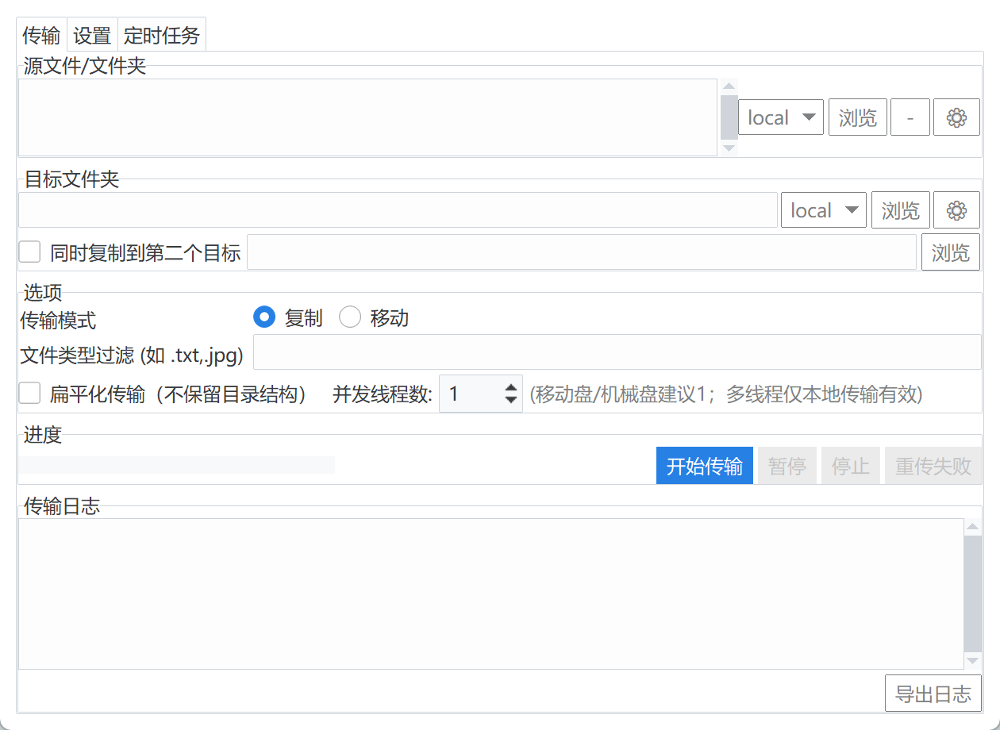
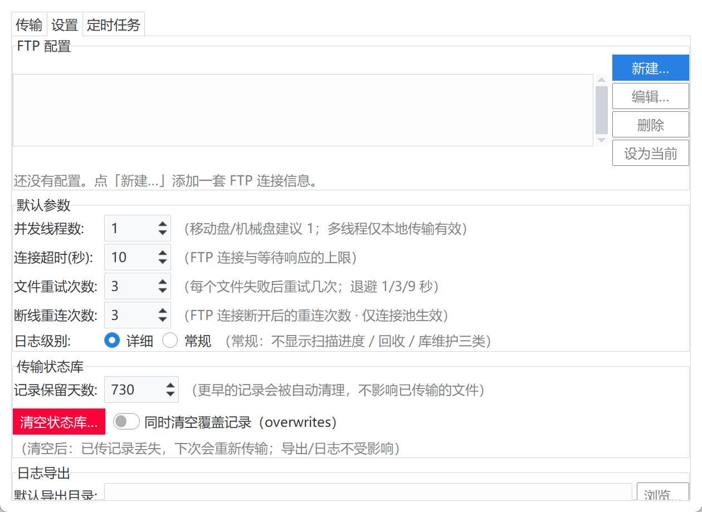

# transfer — 文件传输工具

本地硬盘 ↔ FTP 服务器之间批量传文件的 Windows 桌面工具。整个文件夹递归传，复制或移动，
支持断点续传——几百 TB 传到一半断了，接着往下跑，不用从头再来。

三档壳，**同一套传输内核**：`--tk` 真 Tk 窗口 / `--c3` WebView2 窗口壳 / `--c4` 系统浏览器。
不带参数时由 `host_probe` 自检挑一档（只会挑 C3 或 C4）。

> 本文只是入口页。**使用者请读 [`README_FINAL.md`](README_FINAL.md)**（写给不懂编程的人），
> **开发者请读 [`PROJECT_STATE.md`](PROJECT_STATE.md)**（319 KB，设计与踩坑全在里面）。

---

## 界面

传输页（多源列表、目标目录、第二目标、进度与日志）：



设置页（多套 FTP 配置、并发与重试参数、状态库维护）：



## 能力

- 多源传输：一次加好几个源，点一下「开始传输」按顺序一个接一个传
- 复制 / 移动，递归子目录，文件覆盖策略可选
- 断点续传：中断后从已传位置继续，进度落在本地状态库
- 失败清单：失败条目落成 `.log`，可点「重传失败」只重跑那几条
- 多套 FTP 配置（主机 / 口令 / 远端目录），一键切换「设为当前」
- 第二目标目录：一次同时投递到两处
- 定时任务：写进 Windows 计划任务，无头跑 `--run-task <名字>`，退出码即结果
- 实时速度 / 日志导出 / 清空状态库

## 直接使用（exe）

打包后的 exe 双击即用，免装 Python。仓库里**不含** exe（`.gitignore` 屏蔽 `*.exe`，
二进制不进版本库），需要自己打一次，见下面「打包」一节。

> 判断手里的 exe 是否落后于源码：看它的「修改日期」，比项目里任何一个 `.py` 旧就说明该重打了。

## 从源码运行

```bash
pip install -r requirements.txt
python web_app.py --tk       # 纯 Tk 窗口：不装替身、不起浏览器，日常开发用这个
python web_app.py            # 默认：host_probe 自检选档（C3 或 C4）
python web_app.py --c4       # 强制 Web 档，用系统浏览器打开
python web_app.py --c3       # 强制 Web 档，用 WebView2 窗口壳
python web_app.py --port 8123 --no-browser   # 指定端口 / 不起浏览器
```

显式给了参数就**不参与单实例互斥**，也不顺延端口——探针和并排调试要能同时开好几个。
无头模式下由 Windows 计划任务调用 `--run-task <任务名>`，不弹窗。

> `--tk` 是 `file_transfer.__main__` 那条老入口的等价物（同一个 `FileTransferApp`），
> 但走 `web_app.py` 这个统一入口，省得两处入口各自演化。
> 冻结在 2026-10-17 的纯 Tk 老代码留在分支 `tk-only`（标签 `v0.9-tk`），**只作存档、不再维护**。

## 开发约定：改一处还是改三处

| 你改的东西 | 处数 | 动哪里 |
|---|---|---|
| 传输逻辑 / 参数 / 状态 | 1 | `transfer_core` / `config` / `state_db` |
| 装配逻辑（控件怎么连、点一下干什么） | 1 | `file_transfer` / `transfer_form`（三档共用） |
| 纯外观（颜色 / 间距 / 字号） | 2 | ttkbootstrap 主题 ↔ `web/app.css` |
| **新增一个控件或设置项** | **3** | ①Tk 装配 ②`web_host`/`web_kit` 补替身 ③`web/` 三件套 |
| 新增一个对话框 | 2 | `ui_dialogs`（Tk）+ `web_app._dialog` |

**铁律：新增控件时三处必须在同一个 commit 里改完。** 否则会出现「Tk 有、Web 没有」的半成品。
先在 `--tk` 里看效果（启动快），再补 web 侧；替身缺实现会以 `NotImplementedError` 当场报错，
不会拖到发布才暴露。

## 依赖

见 [`requirements.txt`](requirements.txt)。要点：

- 运行必需 `ttkbootstrap` + `Pillow`（界面控件靠 Pillow 现画）+ `pywebview`（C3 档）
- `pyinstaller` 只在打包时用
- 其余全是标准库（tkinter / sqlite3 / ftplib / threading）

## 主要模块

| 文件 | 职责 |
|---|---|
| `web_app.py` | **打包入口**。三档壳：`--tk` 真窗口 / C3 / C4，外加 HTTP 服务与桥 |
| `app_bootstrapper.py` | 启动装配、命令行参数、无头模式 |
| `file_transfer.py` | 主窗口与交互 |
| `transfer_core.py` | 传输核心：复制 / 移动 / 断点 / 失败清单 |
| `ftp_client.py` / `ftp_transfer.py` | FTP 连接操作与传输流程 |
| `state_db.py` | 本地状态库（sqlite），断点记录与 schema 迁移 |
| `config.py` | 配置读写（原子写）、数据落点选择 |
| `transfer_form.py` / `sched_tab.py` / `ui_dialogs.py` | 传输表单 / 定时任务页 / 对话框 |
| `ui_channel.py` | UI 线程泵与跨线程通道 |
| `web_host.py` / `web_kit.py` / `web/` | Web 档宿主替身层、工具层、前端三件套 |
| `host_probe.py` | 开机自检，决定起哪一档 |

## 数据落点

优先级从高到低（`config.py` 里的 `_default_data_dir`）：

1. 环境变量 `FTP_TRANSFER_DATA_DIR`
2. 程序同级 `data\`（源码运行即本目录下的 `data\`；exe 即 exe 同目录）
3. `%LOCALAPPDATA%\文件传输工具\data`（仅打包后兜底，防只读位置闪退）

`data\` 里是配置、状态库、日志，**含 FTP 明文口令，已在 `.gitignore` 中屏蔽，绝不入库**。

## 打包

```bash
pyinstaller 文件传输工具.spec
```

必须用 spec，不能手敲 `pyinstaller -F web_app.py`——手敲出来的包会缺模块，一点开就崩。

## 文档与归档

- `README_FINAL.md` — 使用者说明（版本历史、界面变化、打包步骤）
- `PROJECT_STATE.md` — 开发者文档（设计决策、失败过的方案、契约）
- `SUMMARY.md` — 早期阶段小结
- 旧版 exe 不进仓库，单独归档保存

## 版本

git tag 从 `v1.0.0` 起打，起始于 2026-11-03 这批修复。

## 许可

[MIT](LICENSE) © 2026 xfzxx
